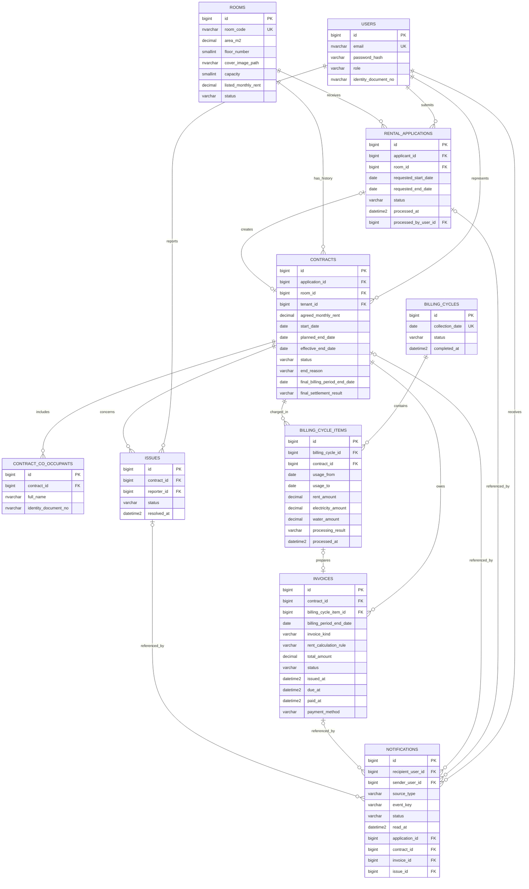

# THIẾT KẾ DATABASE — RENTAL ROOM MANAGEMENT

> **Phiên bản:** 1.0 — bản chưa phát hành, thống nhất ngày 28/10/2026 và cập nhật các quyết định Foundation ngày 29/10/2026.  
> **Nền tảng:** SQL Server; một ứng dụng Spring Boot MVC/Thymeleaf.  
> **Nguồn nghiệp vụ:** [BUSINESS_SPECIFICATION.md](BUSINESS_SPECIFICATION.md).  
> **Phân công:** [MODULE_HANDOFF_AND_IMPLEMENTATION_V2.md](MODULE_HANDOFF_AND_IMPLEMENTATION_V2.md).  
> **Phạm vi tài liệu:** mô hình dữ liệu, ERD, ngữ nghĩa cột, constraint và giao dịch. Đây chưa phải SQL script hoặc Java Entity.

## 1. Mô hình và các quyết định nền tảng

Hệ thống quản lý một tòa nhà, một chủ trọ. Đơn vị cho thuê là phòng. User đứng tên Contract là người đại diện; một User có thể có nhiều Contract cho nhiều phòng. Người ở cùng chỉ là thông tin đi kèm.

| Bảng | Một bản ghi đại diện cho | Owner |
|---|---|---|
| users | Một tài khoản đăng nhập bằng email | M01 |
| rooms | Một phòng vật lý | M02 |
| rental_applications | Một lần đề nghị thuê một phòng | M03 |
| contracts | Một thỏa thuận thuê giữa một đại diện và một phòng | M04 |
| contract_co_occupants | Một người ở cùng được khai báo dưới Contract | M04 |
| billing_cycles | Một kỳ thu định kỳ của tòa nhà, mốc ngày 10 | M05 |
| billing_cycle_items | Một nghĩa vụ của Contract thuộc kỳ và dữ liệu chuẩn bị khoản thu | M05 |
| invoices | Một khoản phải thu đã phát hành và kết quả thanh toán | M05 |
| issues | Một phản ánh/yêu cầu sửa chữa liên quan Contract | M01 |
| notifications | Một bản thông báo đến một người nhận | M06 |

**Không có:** Building/Landlord riêng, Payment/PaymentAttempt, deposit, trả góp, công tơ/đơn giá điện nước, lịch sử ra/vào của người ở cùng, notification_recipients, outbox, Amenity, bảng Dashboard. Không thêm User cho người ở cùng từ quan hệ ở cùng. Dashboard là truy vấn tổng hợp các bảng hiện có.

**Đổi tên đã thống nhất:** email thay login_identifier; processed_at/processed_by_user_id thay resolved_* của đơn; billing_period_end_date thay cycle_anchor_date; EARLY_SETTLEMENT thay loại FINAL; rent_calculation_rule thay rent_calculation_basis. Chỉ payment_method, không payment_channel/gateway_provider. Issue vẫn dùng resolved_at đúng nghĩa đã giải quyết sự cố.

Hai bổ sung kỹ thuật để hiện thực quy tắc không tạo Invoice tổng 0:

- BillingCycleItem có processing_result, rent_amount và processed_at để phân biệt chưa xử lý với đã xử lý không cần thu.
- Contract có dấu kết quả quyết toán sớm và mốc kỳ; M04 lưu kết quả do M05 trả về, không tự tính tiền. Dấu này dùng khi quyết toán sớm **ngoài ngoại lệ Tenant biên ngày 10**, thường trước kỳ thu nên chưa có BillingCycleItem. Tenant trả sớm đúng ngày 10 sau kỳ đã sử dụng là ngoại lệ: kỳ cũ dùng xử lý REGULAR Invoice/BillingCycleItem, không ghi dấu quyết toán sớm hay tạo EARLY_SETTLEMENT.

Đây là dữ liệu kỹ thuật trong 10 bảng hiện có, không thêm nghiệp vụ thu tiền hoặc bảng lịch sử.

## 2. Quy ước dữ liệu chung

| Thành phần | Quy ước |
|---|---|
| PK | id BIGINT IDENTITY, NOT NULL; ID nội bộ, không cần liên tục |
| FK | BIGINT cùng kiểu PK; không mặc định NULL nếu quan hệ bắt buộc |
| Tiền | DECIMAL(19,0), đồng nguyên; không dùng FLOAT/DOUBLE |
| Tính tiền | BigDecimal, giữ chính xác trung gian; HALF_UP tiền thuê cuối, không làm tròn giá ngày trước khi nhân |
| Ngày nghiệp vụ | DATE theo UTC+7; khoảng [from, to), không tính ngày trả |
| Thời điểm | DATETIME2(3), quy ước luôn UTC; kiểu này không tự mang timezone, ứng dụng phải chuyển đổi nhất quán |
| Trạng thái/mã | VARCHAR + CHECK theo tập giá trị; không lưu ordinal của enum |
| Văn bản | NVARCHAR cho tiếng Việt; độ dài trong từ điển là giới hạn kỹ thuật của bản thiết kế |
| NULL | Chưa có sự kiện/dữ liệu hoặc không áp dụng; không thay bằng 0/chuỗi rỗng |
| Xóa | Không có quy tắc xóa chung. Bảo vệ Contract/Invoice và quan hệ bắt buộc khỏi xóa làm mất lịch sử; không dùng xóa vật lý thay workflow kết thúc/INACTIVE. Script đầu tiên không dùng ON DELETE CASCADE; xét delete action theo từng FK khi có nhu cầu xóa thực tế |

**Hai cột chung có ở cả 10 bảng**, không lặp lại trong từng từ điển:

| Cột | Kiểu | NULL? | Ý nghĩa |
|---|---|---|---|
| created_at | DATETIME2(3) | Không | Thời điểm tạo bản ghi, UTC |
| updated_at | DATETIME2(3) | Không | Thời điểm cập nhật gần nhất, UTC; ban đầu bằng created_at |

Hai timestamp này chỉ ghi thời điểm tạo/sửa gần nhất, không phải hệ thống audit lịch sử hoặc lịch sử cư trú. Không tự thêm soft-delete, bảng log thay đổi hoặc cột version cho mọi Entity. Ban đầu `updated_at = created_at`; ứng dụng cấp thời điểm UTC nhất quán khi ghi. Không coi `updated_at` là khóa chống xung đột.

**Cách triển khai Foundation đã chốt:** một `schema.sql` tạo database phát triển cục bộ tên `RentalApartmentDev` khi chưa có, rồi tạo đủ 10 bảng, PK/FK/UNIQUE/CHECK/filtered index; mỗi thành viên chạy thủ công một lần trên SQL Server của mình. Không dùng Flyway hoặc cho Hibernate tự tạo/cập nhật schema. JPA dùng `ddl-auto=validate` để kiểm tra mapping khi khởi động. `seed_admin.sql` riêng tạo Admin mẫu phát triển `admin@rental.local` với số điện thoại/CCCD mẫu và hash BCrypt; mật khẩu bản rõ được chia sẻ riêng ngoài Git. M01 dùng `BCryptPasswordEncoder` để đăng nhập tài khoản mẫu. Không tự tạo/reset Admin sau mỗi lần khởi động. Foundation đã có script/Entity và đã kiểm tra schema cùng JPA `validate` trên SQL Server cục bộ; điều đó chưa thay cho kiểm thử mọi dữ liệu sai hay luồng nghiệp vụ.

## 3. ERD

Sơ đồ thể hiện quan hệ chính. Các FK người tạo/người xử lý và một số cột chi tiết được lược bớt; từ điển dữ liệu phía dưới là định nghĩa đầy đủ.

- User–Contract, Room–Contract, Contract–Invoice: 1–N; nhiều Contract của Room là **qua lịch sử**.
- Application–Contract: mỗi phía 0..1 ở cấp sơ đồ; đơn APPROVED bắt buộc có Contract qua workflow. Contract trực tiếp không có Application.
- BillingCycleItem–Invoice: mỗi phía 0..1; NO_CHARGE không có Invoice; quyết toán sớm có thể không qua BillingCycleItem.
- BillingCycle–Contract là N–N qua BillingCycleItem có dữ liệu nghiệp vụ.
- User–Room là quan hệ thuê qua Contract; không cần bảng UserRoom riêng.
- User–Notification là 1–N theo người nhận; gửi chung nội dung tạo nhiều bản độc lập.
- Điều kiện chỉ một SCHEDULED/ACTIVE/Room cần unique filtered index, không thể hiện đầy đủ bằng đường nối ERD.

## 4. Từ điển dữ liệu

### 4.1. users — M01

Tài khoản đăng nhập; Tenant là User đứng tên Contract, không phải bảng/role riêng. Guest không có bản ghi.

| Cột | Kiểu | NULL? | Khóa/ngữ nghĩa |
|---|---|---|---|
| id | BIGINT IDENTITY | Không | PK |
| email | NVARCHAR(254) | Không | UQ phân biệt hoa/thường; định danh đăng nhập duy nhất, không lưu login_identifier trùng dữ liệu |
| password_hash | VARCHAR(255) | Không | Mật khẩu đã băm, không phải mật khẩu nguyên văn |
| full_name | NVARCHAR(150) | Không | Họ tên hiển thị |
| phone | VARCHAR(20) | Không | Liên hệ bắt buộc khi đăng ký; không UNIQUE |
| identity_document_no | NVARCHAR(30) | Không | CCCD bắt buộc ngay khi đăng ký và trên ADMIN seed; M04 vẫn kiểm tra dữ liệu đại diện hợp lệ trước tạo Contract |
| role | VARCHAR(16) | Không | USER / ADMIN; đăng ký công khai luôn USER |

Email được bỏ khoảng trắng đầu/cuối trước khi ghi/tìm kiếm, **giữ nguyên chữ hoa/thường**. Toàn bộ email phân biệt hoa/thường khi đăng nhập và kiểm tra duy nhất: `An@example.com` và `an@example.com` là hai định danh khác nhau. `users.email` cần collation `CS_AS` tường minh được SQL Server của nhóm hỗ trợ; truy vấn đăng nhập và unique index phải dùng cùng ngữ nghĩa, không tự `LOWER()` email. CCCD không được NULL/chuỗi trắng khi đăng ký hoặc sửa hồ sơ, nhưng không mặc định UNIQUE giấy tờ trên toàn hệ thống hay xác minh bên thứ ba. Họ tên/CCCD hiện tại của User được join để hiển thị cả Contract lịch sử; không có snapshot danh tính trên Contract. Một filtered unique index trên role = ADMIN giới hạn tối đa một Admin; script seed/kiểm tra vận hành bảo đảm tồn tại đúng một tài khoản, index không bảo đảm có ít nhất một.

### 4.2. rooms — M02

Phòng vật lý tồn tại độc lập với người thuê; đổi người thuê tạo Contract mới, không tạo Room mới.

| Cột | Kiểu | NULL? | Khóa/ngữ nghĩa |
|---|---|---|---|
| id | BIGINT IDENTITY | Không | PK |
| room_code | NVARCHAR(30) | Không | UQ; số phòng, ví dụ P101 |
| description | NVARCHAR(2000) | Có | Mô tả |
| area_m2 | DECIMAL(8,2) | Có | Diện tích m² để hiển thị/lọc; CHECK > 0 khi có giá trị |
| floor_number | SMALLINT | Không | Tầng để hiển thị/lọc; CHECK > 0, không dùng tầng 0 hoặc tầng hầm trong dữ liệu hiện tại |
| cover_image_path | NVARCHAR(500) | Không | Tham chiếu một ảnh đại diện của Room; bắt buộc có giá trị không rỗng. Chưa chọn cách lưu trữ/upload, không có gallery |
| capacity | SMALLINT | Không | CHECK > 0; sức chứa gồm người đại diện và người ở cùng |
| listed_monthly_rent | DECIMAL(19,0) | Không | Giá chào thuê hiện tại; CHECK > 0 |
| status | VARCHAR(16) | Không | AVAILABLE / RENTED / INACTIVE |

AVAILABLE: công khai và không có Contract giữ phòng. RENTED: có SCHEDULED/ACTIVE. INACTIVE: Admin đóng, không có SCHEDULED/ACTIVE. Giá niêm yết **chỉ đổi khi không có Contract SCHEDULED/ACTIVE**, kiểm tra lại trong transaction với M04; không làm đổi giá Contract lịch sử. Giảm capacity cần kiểm tra số người trong transaction với M04. UC05–UC07 hiển thị/lọc diện tích, tầng và ảnh đại diện; nếu diện tích chưa có dữ liệu, giao diện không được giả số. Tiện ích có thể ghi trong description, không có bảng Amenity. Không sửa RENTED → INACTIVE độc lập.

### 4.3. rental_applications — M03

Một lần đề nghị thuê một phòng, không phải quan hệ thuê lâu dài. created_at là thời điểm gửi.

| Cột | Kiểu | NULL? | Khóa/ngữ nghĩa |
|---|---|---|---|
| id | BIGINT IDENTITY | Không | PK |
| applicant_id | BIGINT | Không | FK users; người gửi |
| room_id | BIGINT | Không | FK rooms; phòng muốn thuê |
| requested_start_date | DATE | Không | Ngày bắt đầu đề nghị |
| requested_end_date | DATE | Không | Ngày 10 của tháng/năm kết thúc đã chọn |
| status | VARCHAR(16) | Không | PENDING / APPROVED / REJECTED / WITHDRAWN |
| processed_at | DATETIME2(3) | Có | Thời điểm rời PENDING; không phải ngày bắt đầu thuê |
| processed_by_user_id | BIGINT | Có | FK users; Admin duyệt/từ chối hoặc người gửi tự rút; NULL nếu tự động |
| processing_note | NVARCHAR(1000) | Có | Lý do xử lý, đặc biệt đơn cạnh tranh/đơn quá ngày |

CHECK requested_end_date > requested_start_date và ngày kết thúc là 10. PENDING có processed_at/processed_by NULL; trạng thái kết thúc phải có processed_at. Role, người thực hiện và lý do tự động kiểm tra ở Service.

Filtered UNIQUE (applicant_id, room_id) chỉ với status = PENDING; không UNIQUE cặp này trên toàn lịch sử. Application **không có cột giá snapshot**; khi duyệt M04 lấy giá Room hiện hành trong transaction tạo Contract. Quá ngày bắt đầu theo UTC+7 tự REJECTED, ghi lý do và processed_by NULL. Khi duyệt phải kiểm tra lại ngày và phòng; không tự dịch ngày hoặc backdate.

### 4.4. contracts — M04

Ai thuê phòng nào, giá chốt bao nhiêu, thời hạn nào, kết thúc theo lý do gì. `tenant_id` giữ nguyên; màn hình join User hiện tại để lấy họ tên/CCCD, kể cả Contract lịch sử. Không lưu snapshot danh tính, không sửa tenant/room/giá/planned_end_date đã chốt bằng CRUD chung; không có nghiệp vụ gia hạn hợp đồng. Thuê tiếp là Contract mới theo quy tắc tạo mới.

| Cột | Kiểu | NULL? | Khóa/ngữ nghĩa |
|---|---|---|---|
| id | BIGINT IDENTITY | Không | PK |
| application_id | BIGINT | Có | FK rental_applications; NULL khi thuê trực tiếp; duy nhất nếu có |
| room_id | BIGINT | Không | FK rooms |
| tenant_id | BIGINT | Không | FK users; đại diện, không UNIQUE vì một người thuê nhiều phòng |
| agreed_monthly_rent | DECIMAL(19,0) | Không | Sao **đúng** rooms.listed_monthly_rent hiện hành trong transaction tạo Contract, > 0; nguồn tính tiền bất biến, Admin không nhập giá khác |
| start_date | DATE | Không | Ngày bắt đầu nghiệp vụ |
| planned_end_date | DATE | Không | Thời hạn gốc, ngày 10; không ghi đè khi kết thúc sớm |
| effective_end_date | DATE | Có | Ngày kết thúc thực tế khi ENDED; không tính ngày này |
| status | VARCHAR(16) | Không | SCHEDULED / ACTIVE / ENDED / CANCELLED |
| end_reason | VARCHAR(32) | Có | NATURAL_EXPIRY / TENANT_EARLY_EXIT / ADMIN_STOP_SERVICE; dùng khi ENDED |
| activated_at | DATETIME2(3) | Có | Lúc hệ thống ghi ACTIVE; không thay start_date |
| ended_at | DATETIME2(3) | Có | Lúc hệ thống ghi ENDED; có thể khác ngày kết thúc thực tế nếu job chạy trễ |
| cancelled_at | DATETIME2(3) | Có | Lúc Admin hủy SCHEDULED trước ngày bắt đầu |
| created_by_user_id | BIGINT | Không | FK users; Admin tạo trực tiếp/duyệt đơn |
| closed_by_user_id | BIGINT | Có | FK users; Admin hủy/kết thúc sớm; NULL khi Scheduler kết thúc tự nhiên |
| closing_note | NVARCHAR(1000) | Có | Ghi chú hủy/kết thúc |
| final_billing_period_end_date | DATE | Có | Mốc kỳ đã quyết toán **sớm ngoài ngoại lệ Tenant biên 10**, kể cả NO_CHARGE; NULL cho hết hạn tự nhiên và Tenant trả sớm đúng biên 10 dùng REGULAR |
| final_settlement_result | VARCHAR(16) | Có | INVOICED / NO_CHARGE do M05 trả; M04 lưu để ngăn xử lý lại |
| settled_at | DATETIME2(3) | Có | Thời điểm hoàn tất lập khoản quyết toán; không phải thời điểm đã thu tiền |

Ràng buộc:

- planned_end_date > start_date, ngày 10. Khi tạo: hôm nay <= start_date <= hôm nay + 10 ngày, kiểm tra Service.
- ENDED: effective_end_date/end_reason/ended_at bắt buộc; start_date <= effective_end_date <= planned_end_date. NATURAL_EXPIRY có effective_end_date = planned_end_date; lý do kết thúc sớm có effective_end_date < planned_end_date.
- SCHEDULED/ACTIVE: effective_end_date/end_reason/ended_at/cancelled_at NULL. ACTIVE có activated_at; SCHEDULED chưa có activated_at.
- CANCELLED: cancelled_at và Admin đóng bắt buộc, chưa activated_at; effective_end_date/end_reason/ended_at NULL. Hủy chỉ trước ngày bắt đầu, kiểm tra giờ/ngày ở Service.
- ENDED có activated_at, cancelled_at NULL. Kết thúc sớm có closed_by_user_id; tự nhiên không có người đóng.
- Ba cột kết quả quyết toán sớm cùng có giá trị khi ENDED sớm, **trừ ngoại lệ Tenant biên ngày 10**; các trường hợp còn lại cùng NULL. Ngoại lệ `end_reason = TENANT_EARLY_EXIT`, `effective_end_date` là ngày 10 sau kỳ đã ở: ba cột này NULL vì REGULAR Invoice/BillingCycleItem của kỳ cũ xử lý nghĩa vụ, dù Contract vẫn kết thúc sớm. Mốc kỳ nếu có phải ngày 10. INVOICED phải có EARLY_SETTLEMENT Invoice khớp Contract/mốc kỳ; NO_CHARGE không có Invoice cho nghĩa vụ đó. Kiểm tra chéo với ngày/kỳ/Invoice trong transaction, không suy ra chỉ từ CHECK đơn bảng.
- `SCHEDULED` đến `start_date` tự ACTIVE dù khách không đến; không auto CANCELLED. Admin xử lý chủ động qua trạng thái hiện có. Kết thúc ACTIVE trước hạn chỉ với `effective_end_date` bằng ngày nghiệp vụ hiện tại UTC+7; không nhập ngày quá khứ/tương lai. Mốc `ended_at` là lúc ghi, không phải ngày nghiệp vụ.
- Filtered UNIQUE room_id với tập status IN (SCHEDULED, ACTIVE). Một index chung cho cả hai trạng thái, khai báo trong `schema.sql`; không đặt UNIQUE toàn bảng trên `room_id` qua Entity vì Room vẫn cần nhiều Contract lịch sử.
- Filtered UNIQUE application_id khi khác NULL; duyệt từ đơn phải khớp applicant/room. Không tạo đơn giả cho thuê trực tiếp.

### 4.5. contract_co_occupants — M04

Danh sách thông tin người ở cùng của Contract; không chứa người đại diện lần thứ hai, không biểu diễn lịch sử biến động.

| Cột | Kiểu | NULL? | Khóa/ngữ nghĩa |
|---|---|---|---|
| id | BIGINT IDENTITY | Không | PK |
| contract_id | BIGINT | Không | FK contracts |
| full_name | NVARCHAR(150) | Không | Họ tên |
| identity_document_no | NVARCHAR(30) | Không | Giấy tờ bắt buộc khi khai báo |
| phone | VARCHAR(20) | Có | Liên hệ tùy chọn |

Không user_id, move_in_date, move_out_date hoặc status cư trú. Chỉ Admin quản lý. UNIQUE `(contract_id, identity_document_no)` để chặn trùng CCCD trong cùng Contract; chuẩn hóa/loại chuỗi trắng trước khi so sánh. Không UNIQUE giấy tờ toàn lịch sử. Service kiểm tra 1 người đại diện + số người ở cùng <= capacity, kiểm soát hai lần thêm đồng thời và chặn sửa danh sách khi Contract ENDED/CANCELLED. Contract kết thúc thì quyền ở theo Contract chấm dứt; không tạo sự kiện ra/vào cho từng người.

### 4.6. billing_cycles — M05

Một kỳ thu toàn tòa nhà. COMPLETED nghĩa là đã xử lý các khoản thuộc kỳ, không có nghĩa Tenant đã thanh toán.

| Cột | Kiểu | NULL? | Khóa/ngữ nghĩa |
|---|---|---|---|
| id | BIGINT IDENTITY | Không | PK |
| collection_date | DATE | Không | UQ; ngày 10 kết thúc kỳ chuẩn, ví dụ 2026-11-10 |
| status | VARCHAR(20) | Không | PENDING_INPUT / COMPLETED |
| completed_at | DATETIME2(3) | Có | Thời điểm hoàn tất phát hành/ghi NO_CHARGE cho tập nghĩa vụ |

CHECK ngày collection_date = 10; COMPLETED có completed_at, PENDING_INPUT thì NULL. Kỳ chuẩn suy ra từ lịch: [10 tháng trước, collection_date); không trừ cố định 30 ngày. Nếu không có nghĩa vụ sau khi xác định đầy đủ tập cần thu thì có thể hoàn tất kỳ rỗng. Chỉ tạo/mở bước nhập bắt buộc cho kỳ đã đến hạn; quyết toán trước kỳ không tự mở kỳ tương lai để khóa giao diện Admin.

### 4.7. billing_cycle_items — M05

Một Contract cần xử lý trong một kỳ và dữ liệu chuẩn bị. Admin nhập **tiền**, không nhập công tơ. Room và đại diện truy qua Contract để tránh lưu lặp.

| Cột | Kiểu | NULL? | Khóa/ngữ nghĩa |
|---|---|---|---|
| id | BIGINT IDENTITY | Không | PK |
| billing_cycle_id | BIGINT | Không | FK billing_cycles |
| contract_id | BIGINT | Không | FK contracts |
| usage_from | DATE | Không | Đầu khoảng sử dụng cần thu |
| usage_to | DATE | Không | Cuối khoảng, không tính ngày này |
| electricity_amount | DECIMAL(19,0) | Có | NULL chưa nhập; 0 đã nhập giá trị 0 |
| water_amount | DECIMAL(19,0) | Có | NULL chưa nhập; 0 không có khoản nước |
| input_completed_at | DATETIME2(3) | Có | Lúc Admin chốt đủ hai khoản điện nước |
| entered_by_user_id | BIGINT | Có | FK users; Admin nhập/chốt |
| rent_amount | DECIMAL(19,0) | Có | Tiền thuê M05 tính/chốt lúc xử lý; ban đầu NULL, không phải field Admin tự nhập |
| processing_result | VARCHAR(16) | Không | PENDING / INVOICED / NO_CHARGE, ban đầu PENDING |
| processed_at | DATETIME2(3) | Có | Lúc nghĩa vụ được xử lý xong; khác lúc nhập điện nước |

UNIQUE (billing_cycle_id, contract_id). Thêm UNIQUE (id, contract_id) làm khóa tham chiếu cho **FK ghép bắt buộc** của Invoice ở mục 6. Đây là khóa hỗ trợ toàn vẹn, không tạo quan hệ nghiệp vụ mới.

- Các khoản tiền nếu có thì >= 0; usage_from <= usage_to.
- input_completed_at có giá trị thì hai khoản điện nước và entered_by_user_id phải có. Chưa chốt thì chưa phát hành.
- PENDING: rent_amount/processed_at NULL; có thể đã nhập đủ điện nước nhưng phát hành lỗi.
- INVOICED: có rent_amount, đủ điện nước, processed_at và tổng > 0; Service bảo đảm có Invoice đúng nghĩa vụ.
- NO_CHARGE: rent_amount, electricity_amount, water_amount đều bằng 0, đủ thông tin chốt và processed_at; không có Invoice cho nghĩa vụ đó.
- Sau INVOICED/NO_CHARGE, không sửa các dữ kiện khoản thu bằng form nhập thông thường.

Ví dụ kỳ 10/11 có C01/P101 điện 180.000 nước 60.000; C02/P102 chưa nhập (NULL); C03/P103 điện 0 nước 50.000. Có ba dòng chi tiết; C02 chặn hoàn tất kỳ, C03 không thiếu tiền điện. Hai Contract lần lượt thuê cùng phòng trong kỳ được nhập riêng, không UNIQUE Room–kỳ.

### 4.8. invoices — M05

Khoản phải thu đã phát hành, tổng > 0. Thông tin tiền là snapshot; lịch sử thanh toán truy vấn chính Invoice PAID. Không lưu DRAFT hoặc từng lần thử sandbox. Tenant trả sớm đúng ngày 10 sau kỳ đã ở dùng Invoice REGULAR của kỳ đó, không tạo EARLY_SETTLEMENT cho kỳ mới 0 ngày.

| Cột | Kiểu | NULL? | Khóa/ngữ nghĩa |
|---|---|---|---|
| id | BIGINT IDENTITY | Không | PK |
| contract_id | BIGINT | Không | FK contracts; xác định người chịu khoản thu và phòng |
| billing_cycle_item_id | BIGINT | Có | Tham gia FK ghép cùng contract_id tới billing_cycle_items; REGULAR bắt buộc, EARLY_SETTLEMENT có thể NULL. Nhánh Tenant trả sớm đúng biên 10 phải dùng REGULAR item kỳ cũ |
| billing_period_end_date | DATE | Không | Mốc ngày 10 của kỳ chuẩn; không phải issued_at/due_at/ngày trả thực tế |
| invoice_kind | VARCHAR(24) | Không | REGULAR / EARLY_SETTLEMENT |
| usage_from | DATE | Không | Đầu khoảng sử dụng liên quan |
| usage_to | DATE | Không | Cuối khoảng sử dụng, không tính ngày này |
| monthly_rent_snapshot | DECIMAL(19,0) | Không | Giá từ Contract tại lúc lập; CHECK > 0, không lấy giá Room |
| rent_calculation_rule | VARCHAR(32) | Không | Mã quy tắc, không phải số tiền |
| prorated_days | INT | Có | Số ngày cho công thức theo ngày; NULL khi thu nguyên kỳ |
| rent_amount | DECIMAL(19,0) | Không | Tiền thuê cuối sau HALF_UP |
| electricity_amount | DECIMAL(19,0) | Không | Điện đã chốt |
| water_amount | DECIMAL(19,0) | Không | Nước đã chốt |
| total_amount | DECIMAL(19,0) | Không | Tổng ba khoản, > 0 |
| status | VARCHAR(16) | Không | UNPAID / OVERDUE / PAID |
| issued_at | DATETIME2(3) | Không | Lúc phát hành, UTC |
| due_at | DATETIME2(3) | Không | issued_at + 48 giờ, cố định |
| paid_at | DATETIME2(3) | Có | Thời điểm hệ thống ghi nhận thanh toán hợp lệ; không dùng thay ngày giao dịch do gateway cung cấp khi đối chiếu |
| payment_method | VARCHAR(24) | Có | SANDBOX / CASH / BANK_TRANSFER; chỉ ghi khi PAID, kể cả Admin đối chiếu gateway vẫn là SANDBOX |
| payment_reference | NVARCHAR(128) | Có | Tham chiếu thành công nếu có, ví dụ minh họa TXN-20261110-008532; không phải Invoice ID |
| confirmed_by_user_id | BIGINT | Có | FK users; Admin xác nhận ngoài hệ thống/đối chiếu; tự động xác minh sandbox thì NULL |

| rent_calculation_rule | Điều kiện | Tiền thuê | prorated_days |
|---|---|---|---|
| FIRST_PRORATED | REGULAR, kỳ đầu < 14 ngày | Giá / 30 × ngày, HALF_UP cuối | Số ngày > 0 và < 14 |
| MONTHLY_FULL | REGULAR, kỳ đầu >= 14 hoặc kỳ thường | Giá tháng | NULL |
| TENANT_EARLY_FULL | EARLY_SETTLEMENT, Tenant trả sớm | Nguyên kỳ đang sử dụng | NULL |
| ADMIN_STOP_PRORATED | EARLY_SETTLEMENT, Admin ngừng cung cấp | Giá / 30 × ngày thực tế | Số ngày >= 0 |

Ràng buộc và ý nghĩa:

- UNIQUE (contract_id, billing_period_end_date), không đưa invoice_kind vào khóa.
- Filtered UNIQUE billing_cycle_item_id khi khác NULL. FK ghép (billing_cycle_item_id, contract_id) bảo đảm dòng chuẩn bị cùng Contract; Service kiểm tra kỳ của dòng = billing_period_end_date.
- Mốc kỳ ngày 10; usage_from <= usage_to <= billing_period_end_date; Service kiểm tra khoảng nằm trong kỳ chuẩn và trong thời gian hợp đồng. Không cấm tuyệt đối khoảng 0 ngày vì kết thúc cùng ngày có thể phát sinh tiền theo chính sách hoặc điện nước.
- Tiền thuê kỳ, điện và nước không âm; total_amount = rent + electricity + water và > 0; monthly_rent_snapshot > 0. `rent_amount = 0` vẫn hợp lệ khi quy tắc theo ngày cho ra 0 hoặc khoản cần thu không gồm tiền thuê; tổng 0 được ghi NO_CHARGE ở nghĩa vụ thay vì tạo Invoice.
- REGULAR bắt buộc item; FIRST_PRORATED/MONTHLY_FULL chỉ đi với REGULAR; hai quy tắc kết thúc sớm **ngoài ngoại lệ Tenant biên ngày 10** chỉ đi với EARLY_SETTLEMENT. Tenant trả sớm đúng ngày 10 sau kỳ đã sử dụng không tạo Invoice mới cho kỳ 0 ngày; REGULAR kỳ cũ giữ công thức đã phát hành hoặc được phát hành sau khi chốt đủ điện nước.
- due_at bằng issued_at + 48 giờ; không thay theo Notification hoặc lúc Scheduler chạy.
- PAID có paid_at và payment_method. CASH/BANK_TRANSFER bắt buộc confirmed_by_user_id là Admin. SANDBOX tự xác minh có confirmed_by NULL; nếu Admin xác nhận **giao dịch gateway đã xác minh và nhận đủ** sau callback trễ/thất lạc/xung đột thì ghi Admin, vẫn giữ SANDBOX đúng nguồn tiền. Nếu Invoice đã PAID, không ghi đè paid_at/method/reference/confirmed_by; hai khoản tiền thực tế xử lý ngoài hệ thống.
- UNPAID/OVERDUE có paid_at/payment_method/payment_reference/confirmed_by NULL. Dấu callback bất thường nằm ở log phục vụ đối chiếu, không điền vào các field xác nhận thành công trước khi được xử lý.
- Không UNIQUE payment_reference chung cho mọi phương thức; quy tắc tham chiếu tùy gateway cần xác minh trước khi thêm constraint theo gateway.
- Không lưu tenant_id/room_id lặp trên Invoice; Query M05 join Contract để trả DTO có thông tin này.
- Khóa dữ kiện khoản tiền, kỳ và căn cứ tính sau phát hành. Chỉ cập nhật trạng thái/thông tin xác nhận qua command M05. Sai tiền xử lý ngoài đời không làm thay đổi Invoice hoặc tự xóa nợ.

### 4.9. issues — M01

Một yêu cầu của đại diện cho lần thuê cụ thể; không gắn riêng Room khiến người thuê mới nhận nhầm lịch sử.

| Cột | Kiểu | NULL? | Khóa/ngữ nghĩa |
|---|---|---|---|
| id | BIGINT IDENTITY | Không | PK |
| contract_id | BIGINT | Không | FK contracts |
| reporter_id | BIGINT | Không | FK users; phải là đại diện khi tạo |
| title | NVARCHAR(200) | Không | Tiêu đề |
| description | NVARCHAR(4000) | Không | Nội dung |
| status | VARCHAR(16) | Không | OPEN / IN_PROGRESS / RESOLVED |
| handled_by_user_id | BIGINT | Có | FK users; Admin xử lý |
| admin_response | NVARCHAR(4000) | Có | Phản hồi hiện tại; không phải bảng hội thoại |
| in_progress_at | DATETIME2(3) | Có | Bắt đầu xử lý |
| resolved_at | DATETIME2(3) | Có | Giải quyết xong |

Tạo chỉ khi Contract ACTIVE của đúng người. OPEN chưa có các mốc xử lý; IN_PROGRESS có in_progress_at và Admin; RESOLVED có cả hai mốc và Admin. Service bảo đảm chuyển OPEN → IN_PROGRESS → RESOLVED và thời điểm không đảo ngược. Contract kết thúc không tự đóng Issue đã tạo; Admin tiếp tục xử lý OPEN/IN_PROGRESS đến RESOLVED, Tenant vẫn xem được lịch sử. Không có file/ảnh đính kèm Issue.

### 4.10. notifications — M06

Một dòng là một bản thông báo cho một người. Gửi cùng nội dung cho An và Bình tạo hai dòng, trạng thái đọc độc lập. Không quản lý đợt gửi chung.

| Cột | Kiểu | NULL? | Khóa/ngữ nghĩa |
|---|---|---|---|
| id | BIGINT IDENTITY | Không | PK |
| recipient_user_id | BIGINT | Không | FK users; người được xem/đánh dấu đọc |
| source_type | VARCHAR(16) | Không | MANUAL / SYSTEM |
| sender_user_id | BIGINT | Có | FK users; Admin soạn MANUAL; SYSTEM thì NULL |
| title | NVARCHAR(200) | Không | Tiêu đề |
| body | NVARCHAR(4000) | Không | Nội dung |
| status | VARCHAR(8) | Không | UNREAD / READ |
| read_at | DATETIME2(3) | Có | Lúc ứng dụng ghi nhận đã đọc |
| event_key | VARCHAR(200) | Có | Khóa sự kiện ổn định để retry; SYSTEM bắt buộc, MANUAL có thể NULL |
| application_id | BIGINT | Có | FK rental_applications; tham chiếu chính nếu có |
| contract_id | BIGINT | Có | FK contracts; tham chiếu chính nếu có |
| invoice_id | BIGINT | Có | FK invoices; tham chiếu chính nếu có |
| issue_id | BIGINT | Có | FK issues; tham chiếu chính nếu có |

CHECK tối đa một trong bốn FK nghiệp vụ khác NULL; thông báo thủ công có thể không có FK nghiệp vụ. MANUAL có sender là Admin (role kiểm tra Service); SYSTEM có sender NULL, kể cả sự kiện gốc do Admin thực hiện. READ có read_at, UNREAD thì NULL.

Filtered UNIQUE (event_key, recipient_user_id) khi event_key khác NULL. Ví dụ INVOICE_ISSUED:9001, INVOICE_OVERDUE:9001 là hai sự kiện khác nhau. Không dùng khóa ngẫu nhiên mới ở mỗi lần retry. Nội dung tự động chỉ tạo sau commit; lỗi ghi log/retry có giới hạn, không rollback nghiệp vụ và không thay due_at.

## 5. Trạng thái, kỳ thu và tính tiền

### 5.1. Các vòng đời độc lập

| Đối tượng | Luồng |
|---|---|
| Application | PENDING → APPROVED / REJECTED / WITHDRAWN |
| Contract | SCHEDULED → ACTIVE → ENDED; SCHEDULED → CANCELLED trước ngày bắt đầu |
| Room | AVAILABLE → RENTED khi giữ; RENTED → AVAILABLE khi kết thúc thường hoặc → INACTIVE qua workflow đóng; INACTIVE chỉ Admin mở lại |
| BillingCycle | PENDING_INPUT → COMPLETED, kể cả có nghĩa vụ NO_CHARGE |
| BillingCycleItem | PENDING → INVOICED / NO_CHARGE |
| Invoice | UNPAID → PAID hoặc OVERDUE; OVERDUE → PAID qua Admin xác nhận đã thu đủ ngoài hệ thống hoặc đối chiếu giao dịch SANDBOX đã xác minh và nhận đủ |
| Issue | OPEN → IN_PROGRESS → RESOLVED |
| Notification | UNREAD → READ |

CHECK chỉ kiểm tra trạng thái hiện tại; các đường chuyển, quyền và điều kiện liên bảng do Service/transaction bảo đảm. ENDED không kéo Invoice thành PAID; COMPLETED không có nghĩa đã thu xong; EARLY_SETTLEMENT không phải trạng thái Contract.

### 5.2. Khoảng sử dụng khác với mốc kỳ

- Kỳ 10/11 là [10/10, 10/11), không lấy mốc trước + 30 ngày.
- Bắt đầu 01/11, thu 10/11: [01/11, 10/11) = 9 ngày. Giá 3.000.000 → thuê 900.000 trước điện nước.
- Giá 2.000.000, 7 ngày: HALF_UP(2.000.000 × 7 / 30) = 466.667. Không làm tròn đơn giá ngày trước.
- Kết thúc sớm 04/11: usage_to = 04/11 nhưng billing_period_end_date = 10/11; phát hành ngay 04/11. Tenant trả sớm thu nguyên kỳ; Admin stop dùng số ngày thực tế.
- Tenant trả sớm 10/12 sau một khoảng đã ở: mốc kỳ cũ = 10/12, không tạo tiền thuê kỳ [10/12, 10/01). Nghĩa vụ kỳ cũ là REGULAR (hoặc NO_CHARGE trên item), không tạo EARLY_SETTLEMENT thứ hai hay tính lại tiền thuê nguyên kỳ.
- Trường hợp ACTIVE bắt đầu và kết thúc cùng ngày: không tự coi là hủy SCHEDULED. Tenant trả sớm vẫn áp dụng nguyên kỳ; Admin stop dùng 0 ngày và điện nước. Nếu ngày đó là ngày 10 thì kỳ gắn với thời điểm bắt đầu là kỳ kết thúc ngày 10 tháng sau; quy tắc không thu kỳ mới khi trả ở biên áp dụng cho hợp đồng đã ở trước biên đó.

M06 phải trả rõ khoảng sử dụng, mốc kỳ, reason, quy tắc và tiền; không chỉ trả một total không giải thích được. Các kỳ trước chưa lập/thu vẫn tồn tại độc lập; một quyết toán cuối không miễn mọi kỳ cũ.

### 5.3. Không phát hành Invoice tổng 0 nhưng không mất nghĩa vụ

**Định kỳ:** chốt đủ điện nước, M05 tính rent_amount. Nếu cả ba khoản bằng 0, lưu item.NO_CHARGE và processed_at. Kỳ hoàn tất khi mọi item là INVOICED hoặc NO_CHARGE. Không tạo Invoice PAID giả 0 đồng.

**Kết thúc sớm ngoài ngoại lệ Tenant biên ngày 10:** coordinator khóa Contract; M06 tính, M05 kiểm tra nghĩa vụ cùng mốc kỳ và trả INVOICED + ID hoặc NO_CHARGE + ID NULL. M04 lưu final_billing_period_end_date/final_settlement_result/settled_at cùng giao dịch kết thúc. NO_CHARGE nghĩa là cả ba khoản đã xác nhận bằng 0, không phải thiếu dữ liệu nhập.

**Tenant trả sớm đúng biên ngày 10 sau kỳ đã sử dụng:** M04 chuyển ENDED với lý do TENANT_EARLY_EXIT nhưng không ghi dấu `final_*`/`settled_at`; M05 xử lý REGULAR item kỳ cũ. Nếu kỳ cũ chưa phát hành, M04/Room có thể hoàn tất kết thúc trước; nghĩa vụ vẫn còn và Admin phải chốt đủ điện nước để M05 phát hành một lần từ item (hoặc NO_CHARGE khi tổng 0). Nếu đã phát hành, giữ nguyên Invoice và điện nước đã chốt; sai sót sau phát hành xử lý ngoài hệ thống. Không tạo item/Invoice của kỳ mới 0 ngày chỉ vì thao tác kết thúc.

Khi tạo kỳ định kỳ, kiểm tra Invoice và dấu quyết toán sớm theo đúng Contract + mốc kỳ; nghĩa vụ đã giải quyết được bỏ qua, không loại toàn bộ Contract khỏi các kỳ cũ. Nếu item đã được tạo trước khi quyết toán, M05 hoàn tất item tương ứng theo kết quả; Invoice dương liên kết item đó. Việc kiểm tra/lưu cần cùng cơ chế khóa Contract để hai workflow không chạy vượt nhau.

Không tạo BillingCycle tương lai chỉ để lưu quyết toán sớm, tránh khóa giao diện Admin trước ngày thu. M04 chỉ giữ dấu kết quả do M05 trả; mọi dữ liệu tiền/Invoice vẫn do M05 ghi.

## 6. PK, FK, UNIQUE, CHECK và index

### 6.1. Các khóa duy nhất bắt buộc

| Bảng | Khóa | Điều kiện |
|---|---|---|
| users | email | Toàn bảng, phân biệt hoa/thường theo collation CS_AS của cột |
| users | role | Chỉ ADMIN; tối đa một, seed bảo đảm tồn tại |
| rooms | room_code | Toàn bảng |
| rental_applications | applicant_id, room_id | Chỉ PENDING |
| contracts | application_id | Chỉ khác NULL |
| contracts | room_id | Một filtered unique index chung cho SCHEDULED và ACTIVE |
| contract_co_occupants | contract_id, identity_document_no | Toàn bảng; chống cùng CCCD lặp trong một Contract |
| billing_cycles | collection_date | Toàn bảng |
| billing_cycle_items | billing_cycle_id, contract_id | Toàn bảng |
| billing_cycle_items | id, contract_id | Hỗ trợ FK ghép Invoice |
| invoices | contract_id, billing_period_end_date | Toàn bảng, kể cả PAID; không thêm invoice_kind vào khóa |
| invoices | billing_cycle_item_id | Chỉ khác NULL |
| notifications | event_key, recipient_user_id | Chỉ event_key khác NULL |

SQL Server dùng unique filtered index cho các điều kiện trên; UNIQUE đơn cột nullable thông thường không thay được index lọc vì chỉ cho một NULL. Không dùng computed occupancy flag làm filter khi chưa kiểm tra hỗ trợ SQL Server. Không tách hai index giữ phòng theo từng status vì vẫn lọt một SCHEDULED và một ACTIVE. JPA mapping Room–Contract và status không thay thế index này; `ddl-auto=validate` cũng không xác nhận sự tồn tại của filtered index, nên phải kiểm tra bằng SQL Server thật.

Tất cả FK trong từ điển phải được khai báo. Invoice có FK contract_id riêng và FK ghép (billing_cycle_item_id, contract_id) → billing_cycle_items(id, contract_id); item NULL được phép cho quyết toán sớm. Không dùng FK vòng Application ↔ Contract: chỉ Contract giữ application_id, yêu cầu APPROVED có Contract do transaction bảo đảm.

### 6.2. CHECK và Service

- CHECK enum, sức chứa, giá niêm yết/giá Contract/snapshot > 0, các khoản tiền kỳ không âm, tổng tiền, diện tích > 0 khi không NULL, tầng bắt buộc > 0, ngày kết thúc là 10, thứ tự ngày, trường timestamp/payment theo trạng thái như từ điển.
- CHECK có NULL phải viết IS NULL/IS NOT NULL rõ ràng; biểu thức UNKNOWN không bị SQL Server từ chối như FALSE.
- Các field văn bản bắt buộc phải chặn chuỗi trống/khoảng trắng ở validation, không chỉ NOT NULL.
- Không dùng CHECK dựa vào giờ hiện tại để thay Scheduler: dữ liệu không tự đổi khi thời gian trôi qua.
- Service kiểm tra role, chủ sở hữu, giới hạn start_date hôm nay đến +10, ngày kết thúc sớm bằng hôm nay UTC+7, số người, trạng thái Contract khi sửa người ở cùng, khớp đơn–hợp đồng, khớp kỳ–Invoice, quy tắc tính tiền và tính bất biến sau phát hành. Giá Contract phải sao giá Room hiện hành lúc tạo; Room chỉ đổi giá khi không có SCHEDULED/ACTIVE, kiểm tra cùng transaction/khóa.
- Kết quả NO_CHARGE/INVOICED giữa Contract, item và Invoice là toàn vẹn liên bảng; phải được coordinator/M05 bảo vệ bằng transaction, không chỉ các CHECK riêng lẻ. Riêng Tenant trả sớm đúng biên có `final_*` NULL nhưng vẫn cần REGULAR item/Invoice kỳ cũ được xử lý đúng một lần.

### 6.3. Index đọc dự kiến

Ngoài index duy nhất, cân nhắc index trên Contract(tenant_id), Contract(status, start_date), Contract(status, planned_end_date), Application(status, requested_start_date), Application(room_id, status), Invoice(status, due_at), Invoice(contract_id, issued_at), Issue(reporter_id, created_at), Notification(recipient_user_id, status, created_at), BillingCycle(status, collection_date). Tránh tạo trùng index đã được khóa duy nhất bao phủ; chọn INCLUDE/thứ tự cụ thể sau khi có query thật.

## 7. Giao dịch và chống cạnh tranh

| Workflow | Phần phải cùng thành công/rollback | Owner ghi |
|---|---|---|
| Duyệt đơn | Kiểm tra PENDING/ngày/phòng, tạo Contract, giữ Room, APPROVED và REJECT đơn cạnh tranh | M03 + M04 + M02 |
| Thuê trực tiếp | Contract không Application, giữ Room, REJECT các PENDING cạnh tranh | M04 + M02 + M03 |
| Đổi giá Room | Khóa/kiểm tra không có Contract SCHEDULED/ACTIVE rồi mới ghi listed_monthly_rent; không ảnh hưởng Contract cũ | M02, đọc M04 |
| Hủy SCHEDULED | CANCELLED và Room AVAILABLE/INACTIVE | M04 + M02 |
| Kích hoạt/hết hạn | Chuyển Contract có điều kiện, đồng bộ Room đúng hợp đồng; giữ khả năng truy nghĩa vụ cuối | M04 + M02, phối hợp đọc M05 |
| Lưu điện nước | Lưu dữ liệu nhập bền vững trước phát hành | M05 |
| Phát hành kỳ | Chốt tập nghĩa vụ và dữ liệu, tạo Invoice/NO_CHARGE, cập nhật item và COMPLETED | M05 |
| Kết thúc sớm ngoài ngoại lệ Tenant biên 10 | Kết quả quyết toán/Invoice, dấu quyết toán Contract, ENDED, giải phóng/INACTIVE | M06 tính; M05, M04, M02 ghi |
| Tenant kết thúc sớm đúng biên 10 | ENDED/Room giải phóng; REGULAR item/Invoice kỳ cũ xử lý một lần; không dấu quyết toán sớm/EARLY_SETTLEMENT | M04, M02; M05 phát hành REGULAR khi đủ điện nước |
| Thanh toán/quá hạn | Kiểm tra lại status/due, cập nhật nguyên tử status và thông tin xác nhận | Chỉ M05 |
| Notification thủ công | Một thao tác lưu các bản cho người nhận; chỉ báo thành công sau khi lưu | M06 |

Một application coordinator giữ transaction liên module. Không mỗi bước commit riêng, không gọi gateway/network hoặc tạo Notification tự động bên trong transaction nghiệp vụ chính. Các module gọi port/service của owner, không thêm repository riêng để sửa bảng người khác.

Kiểm tra rồi INSERT không tự chống race. Các luồng giữ/đóng phòng và gửi đơn phải phối hợp trên cùng Room; các luồng phát hành/quyết toán phải kiểm soát trên cùng Contract/nghĩa vụ. Chốt thứ tự khóa thống nhất trước code để tránh deadlock; unique index là lớp bảo vệ cuối. Nếu vi phạm unique/deadlock, rollback và trả lỗi/retry có kiểm soát, không báo thành công giả.

Không để thao tác giải phóng chạy lại chuyển phòng đang có Contract mới về AVAILABLE. Kiểm tra hợp đồng liên quan và trạng thái hiện tại trong transaction. Không thay NO_CHARGE đã chốt thành PENDING để phát hành lại.

Callback chỉ dùng dữ liệu đã xác minh ở server, so khớp Invoice, số tiền và kết quả. Không tin return URL của trình duyệt. Cập nhật PAID có điều kiện; yêu cầu đến sau không ghi đè paid_at/payment_method/reference. Overdue chỉ đổi hàng còn UNPAID. Callback muộn/thất lạc/xung đột cần để Admin tra cứu giao dịch đã xác minh qua nguồn gateway/log vận hành, không tạo bảng Attempt. Nếu chưa PAID và gateway xác nhận đã thu đủ, M05 nhận lệnh Admin đối chiếu và ghi PAID với SANDBOX; nếu PAID thì giữ nguyên. Không tự mở thanh toán OVERDUE thông thường.

## 8. Scheduler và khả năng chạy lại

| Tác vụ | Điều kiện/khóa | Kết quả khi chạy lại |
|---|---|---|
| Kiểm tra đơn quá ngày | PENDING, requested_start_date < ngày UTC+7 hiện tại | Chỉ đổi đơn còn PENDING; giữ dấu xử lý cũ |
| Kích hoạt Contract | SCHEDULED đến hạn, không phụ thuộc khách nhận phòng | Cập nhật cùng Contract, Room vẫn RENTED; không tự hủy no-show |
| Hết hạn Contract | ACTIVE đến planned_end_date | ENDED và giải phóng đúng phòng, không bỏ nghĩa vụ cuối |
| Tạo kỳ | collection_date duy nhất | Đọc kỳ đã có |
| Tạo item | cycle + contract duy nhất, kiểm tra kết quả quyết toán | Không thêm lại dòng/không reset dữ liệu nhập |
| Phát hành | contract + billing_period_end_date duy nhất | Dùng kết quả phù hợp đã có; khác dữ liệu thì báo xung đột |
| Quá hạn | UNPAID, now >= due_at | Không ghi đè PAID |
| Notification | event_key + recipient_user_id | Không tạo bản trùng |

Scheduler tìm những mốc đã đến hạn nhưng chưa xử lý, không chỉ ngày = hôm nay; phải chạy bù khi server khởi động lại. Nếu trạng thái Contract trễ lịch, đồng bộ vòng đời theo thứ tự trước khi dùng nó để phân loại.

Tập nghĩa vụ định kỳ dựa trên khoảng thuê giao với kỳ, Contract không CANCELLED, Invoice/dấu quyết toán chưa xử lý; không chỉ lọc ACTIVE hoặc Room RENTED hiện tại. Contract ENDED ngày 10 vẫn có kỳ cuối. Room có người thuê mới không làm mất nghĩa vụ người cũ. Dữ liệu đủ để chạy bù kỳ cũ mà không chỉnh ngày thực tế.

### 8.1. Tenant trả sớm đúng biên ngày 10 — ngoại lệ đã chốt

Điều kiện: Contract ACTIVE, Tenant chủ động kết thúc **trước** `planned_end_date`, `effective_end_date` bằng ngày nghiệp vụ hiện tại UTC+7 và là ngày 10, Contract đã sử dụng ít nhất một ngày của kỳ vừa kết thúc, chưa dùng ngày nào của kỳ mới. Khi đó ngày 10 là cuối khoảng `[usage_from, usage_to)` của kỳ cũ; không có tiền thuê kỳ mới. Invoice REGULAR cùng `contract_id + billing_period_end_date` xử lý kỳ cũ, kể cả kỳ đầu < 14 ngày. Không áp lại `TENANT_EARLY_FULL`, không tạo EARLY_SETTLEMENT, không sửa Invoice đã phát hành.

Nếu REGULAR chưa phát hành, M05 giữ/tạo BillingCycleItem kỳ cũ, Admin nhập/chốt điện nước của đúng Contract, rồi phát hành REGULAR hoặc ghi NO_CHARGE **một lần**; Contract có thể đã ENDED và Room đã giải phóng. Nếu REGULAR đã phát hành, các khoản điện nước đã chốt trước phát hành; giữ nguyên Invoice. Thiếu/sai tiền phát hiện sau phát hành đi theo chính sách làm việc trực tiếp ngoài hệ thống, không tạo Invoice bù. M05 vẫn truy ra nghĩa vụ kỳ cũ của Contract ENDED.

Nếu một nhánh **không thuộc ngoại lệ trên** gặp Invoice cùng khóa kỳ đã phát hành, M05 chỉ coi idempotent khi khoản tiền/khoảng/căn cứ tính khớp; khác thì báo xung đột, không ghi đè hoặc tạo Invoice thứ hai. Khóa và thứ tự xử lý chung giữa M04/M05 phải ngăn hai luồng quyết toán/phát hành vượt nhau.

## 9. Module ownership và giao tiếp

| Module | Bảng sở hữu | Không được tự làm |
|---|---|---|
| M01 | users, issues | Đổi Contract/Room hoặc ghi Notification trực tiếp |
| M02 | rooms | Tự hủy Contract/phát hành Invoice để đóng phòng |
| M03 | rental_applications | Tự ghi Contract/Room, APPROVED trước khi tạo/giữ thành công |
| M04 | contracts, contract_co_occupants | Ghi InvoiceRepository hoặc tự tính lại quyết toán M06 |
| M05 | billing_cycles, billing_cycle_items, invoices | Đổi Contract/Room hoặc trực tiếp ghi Notification |
| M06 | notifications | Ghi InvoiceRepository; mọi thu thủ công/quá hạn/quyết toán qua M05 |

issueFinalInvoice trả kết quả có result = INVOICED/NO_CHARGE, contractId, billingPeriodEndDate và invoiceId nullable theo result. M04 lưu dấu kết quả sớm; M06 tính công thức, không sở hữu bản ghi Invoice. Với INVOICED trả lại kết quả cũ phải đối chiếu dữ liệu, không coi bất kỳ duplicate key nào cũng thành công.

DTO/port chính: CurrentUser/UserSummary; RoomQuery/RoomOccupancyCommand; ApplicationQuery/Command; ContractCreation/Activity/BillingSnapshot; InvoiceQuery/Command; Notification event có eventKey. DTO dùng ngày và timestamp đúng ngữ nghĩa, không gọi chung tất cả là endDate. Chi tiết chữ ký/lỗi sẽ nằm trong Module Interface Contracts, không tự thêm một bộ tên khác theo từng nhánh.

**Dashboard Admin:** M06 tích hợp màn hình đọc; M02 cung cấp `COUNT Room GROUP BY status`; M05 cung cấp `SUM invoices.total_amount WHERE status = PAID` và số Invoice UNPAID/OVERDUE; M01 cung cấp số Issue `status IN (OPEN, IN_PROGRESS)`. Owner cung cấp query/service, M06 không tự ghi bảng của owner. Không có bảng thống kê hoặc module thứ bảy; số liệu là trạng thái hiện tại trong DB, không phải báo cáo doanh thu ngoài hệ thống.

## 10. Kiểm tra thiết kế theo workflow

| Workflow | Dữ liệu/kết quả phải chứng minh |
|---|---|
| Đăng ký | Email duy nhất, có tên/phone/CCCD/hash; USER, không tự cấp ADMIN; ADMIN seed có CCCD |
| Gửi/rút/duyệt đơn | Một PENDING/cặp, đúng người, đúng ngày; APPROVED gắn Contract hợp lệ |
| Trực tiếp | Contract application_id NULL, đủ CCCD, giá sao Room lúc tạo, reject cạnh tranh |
| SCHEDULED/ACTIVE/CANCELLED/ENDED | Các mốc NULL/khác NULL đúng; SCHEDULED tự ACTIVE dù no-show; Room đồng bộ, không hai hợp đồng giữ phòng, không gia hạn |
| Kỳ ngày 10 | Kỳ đầu đúng ngày, không dùng giá Room, không bỏ Contract vừa ENDED |
| Nhập điện nước | NULL khác 0; đủ toàn bộ trước phát hành; dữ liệu còn khi phát hành lỗi |
| Thanh toán sandbox | Đúng chủ, UNPAID và chưa due; xác minh, PAID một lần, thất bại không ghi paid fields |
| Thu thủ công/quá hạn | M06 qua M05; due cố định; chưa trả vẫn truy được sau ENDED |
| Kết thúc sớm | Chỉ ngày hiện tại UTC+7; Tenant trong kỳ nguyên kỳ, Admin theo ngày; Tenant trả đúng biên 10 dùng REGULAR kỳ cũ; Room cùng nhất quán |
| Tổng 0 | Có dấu xử lý, không Invoice 0 đồng, không lặp vô hạn |
| Sai tiền đã phát hành | Không sửa tiền/giả PAID; công nợ có thể khác thỏa thuận ngoài đời |
| Issue | Đúng Contract ACTIVE lúc tạo; Admin xử lý Issue cũ đến RESOLVED sau Contract ENDED, Tenant xem lịch sử |
| Notification | Đúng người nhận, đọc độc lập, chống trùng retry, lỗi không rollback Invoice |
| Dashboard | M06 đọc count Room theo status từ M02, SUM Invoice PAID/count UNPAID/OVERDUE từ M05, count Issue chưa RESOLVED từ M01 |

Đây là checklist thiết kế, **không đồng nghĩa tất cả trường hợp đã được test**. `schema.sql` đã chạy trên SQL Server cục bộ; metadata bảng/cột/FK/CHECK/index và JPA `validate` đã kiểm tra đạt. Còn phải thử PK/FK/CHECK/index bằng dữ liệu hợp lệ, dữ liệu sai và các thao tác đồng thời, không chỉ kiểm tra metadata. Một SQL Server instance của nhóm và `RentalApartmentDev` cục bộ là đủ cho bước này; đây là kiểm thử Foundation, khác với test end-to-end sáu module sau này.

## 11. Giới hạn và việc tiếp theo

- Sai Invoice sau phát hành giải quyết bên ngoài nhưng giữ nguyên tiền; PAID vẫn đòi nhận đủ tiền trên Invoice. Chưa có credit note/refund/VOID/ghi giảm nợ; báo cáo phản ánh bản ghi, không phải mọi thỏa thuận ngoài hệ thống.
- Chưa có outbox; retry Notification có giới hạn. Chọn số lần/thời gian, log và cơ chế quan sát khi triển khai. Không ghi bí mật gateway/mật khẩu vào log.
- Chọn sandbox và đặc tả xử lý callback/đối chiếu muộn. Không tự suy đoán tên cổng hay định dạng chữ ký/tham chiếu.
- Mapping timestamp UTC và collation `CS_AS` của email phải được xác minh trên SQL Server nhóm dùng. CCCD chỉ trim/không rỗng và giữ số 0 đầu; chưa thêm quy tắc định dạng số chữ số hoặc UNIQUE toàn hệ thống. Thứ tự khóa transaction của các workflow được chốt khi tích hợp module; Foundation không thêm cột version.
- Ngoại lệ biên ngày 10 ở mục 8.1 đã chốt; cần kiểm thử luồng REGULAR phát hành trước/sau thao tác kết thúc và điện nước đúng một lần khi tích hợp.
- Không thêm thời hạn thuê tối thiểu ngoài `planned_end_date > start_date`; giá niêm yết và giá Contract phải > 0. `area_m2` có thể NULL nhưng nếu có thì > 0; `floor_number` bắt buộc > 0. `rent_amount` của một kỳ có thể bằng 0, và nghĩa vụ tổng 0 vẫn dùng NO_CHARGE.
- Chưa chọn nơi lưu ảnh đại diện, cách upload hoặc gateway và phương thức xác minh giao dịch; không suy đoán các quyết định kỹ thuật này. Không có email/OTP, Issue attachment, gallery hay password reset trong 40 UC bắt buộc.
- Xóa dữ liệu xét theo Entity và FK cụ thể; không áp dụng `NO ACTION` như một quy tắc nghiệp vụ chung, nhưng không xóa vật lý làm mất Contract/Invoice lịch sử hoặc thay workflow kết thúc/INACTIVE.
- Foundation đã có `schema.sql`, `seed_admin.sql` và 10 Entity/Enum theo owner; mỗi thành viên tạo database `RentalApartmentDev` bằng script rồi cấu hình `DB_URL`, `DB_USERNAME`, `DB_PASSWORD` trên máy riêng. Tiếp tục kiểm thử constraint bằng dữ liệu hợp lệ/sai, đặc tả interface/coordinator và tích hợp dần workflow; không tự thêm bảng hoặc đổi nghiệp vụ.
